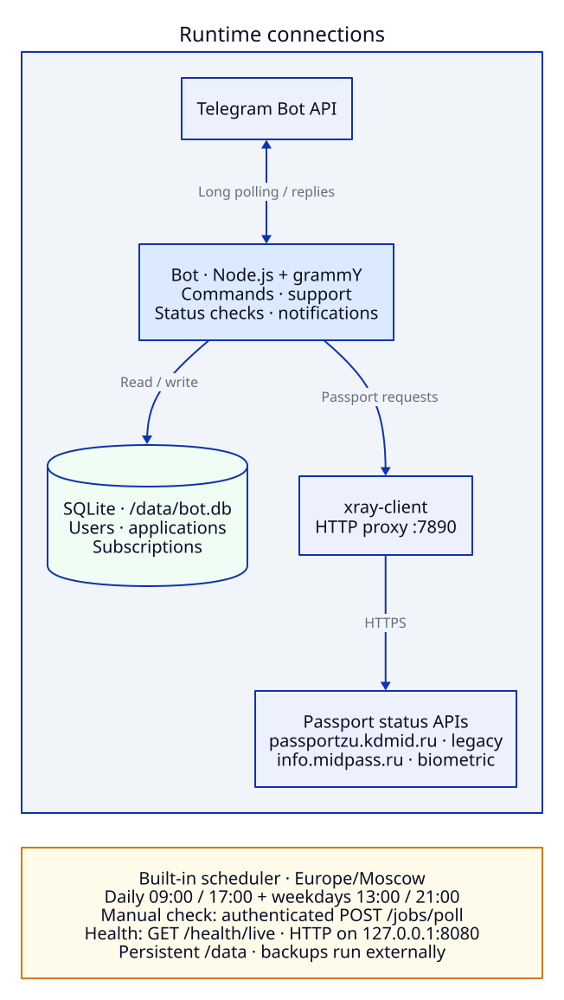

# Info Midpass Bot

Telegram bot for tracking Russian passport applications

## Usage

Required environment: `TELEGRAM_BOT_TOKEN`

```sh
read -r -s TELEGRAM_BOT_TOKEN
export TELEGRAM_BOT_TOKEN
docker compose up -d
```

Backups are handled externally

## Topology



## Navigation


