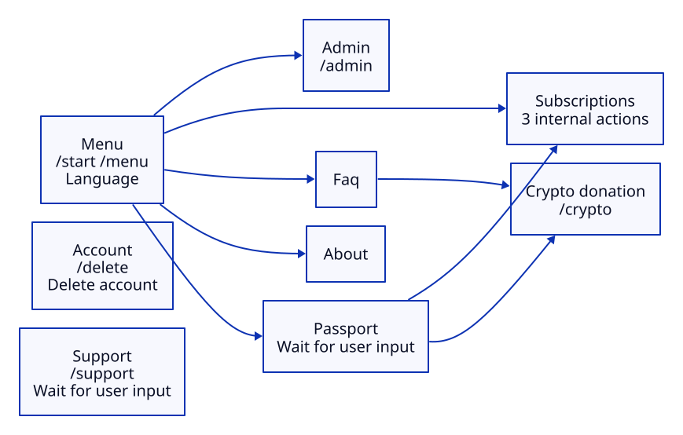

# Info Midpass Bot

Telegram bot for tracking passport application status

## Run

Create a local `.env` file with `TELEGRAM_BOT_TOKEN` and, optionally,
`TELEGRAM_ADMIN_ID` (comma-separated Telegram user IDs). Keep this file private.

```sh
docker build -t info-midpass-bot .
docker run -d --name info-midpass-bot --restart unless-stopped \
  --env-file .env -e DB_PATH=/data/bot.db \
  --mount source=info-midpass-bot-data,target=/data \
  info-midpass-bot
```

Run one instance per bot token. Data is stored in the Docker volume.

## Usage

Use `/start` to add applications and manage subscriptions.
Administrators can use `/admin` to view statistics.

Subscribers receive notifications when an application status changes.

## Data storage

The bot stores minimal user data:

- Public Telegram user_id
- Application numbers

## Topology


